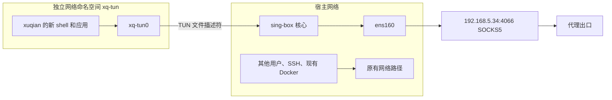

# Mico-system：独立网络命名空间 TUN 方案

> 2026-11-14 更新：下文记录独立命名空间方案。当前已安装的 `xq_proxyon/off/proxystatus` 已升级为用户级入口，影响 xuqian 的全部宿主会话；局域网直连。请以[用户级代理说明](scripts/xq-user-proxy/README.md)为准。`xq_tun run` 仍可用于独立命名空间。

方案日期：2026-11-13。目标主机为 `Mico-system / 192.168.5.173`，应用用户为 `xuqian`，上游为 `192.168.5.34:4066`。

**结论：采用 sing-box 的跨网络命名空间 TUN；只接管从专用入口启动的程序及其子进程。** 代理核心留在宿主网络，TUN 和应用进入独立网络命名空间。方案已实施并完成验收，当前状态见 [部署记录](VPS-TUN部署记录.md)。

可执行安装包及操作方法见 [安装说明](scripts/xq-tun/README.md)。用户调整执行权限后，已通过宿主 sudo 完成安装与自动验收；核心保持运行，开机自启尚未开启。

## 本机检查结果

以下宿主机信息通过 SSH 实测。SSH 主机密钥与本机 `/etc/ssh/ssh_host_ed25519_key.pub` 核对，没有关闭主机身份验证。

| 检查项 | 结果 |
| --- | --- |
| 系统 | Ubuntu 22.04.5 LTS，Linux 6.8.0-138-generic，x86_64 |
| 用户 | `xuqian`，UID/GID `1006`，属于 `sudo` 和 `docker` 组 |
| TUN | `/dev/net/tun` 是 `10,200` 字符设备；已在独立命名空间创建并验证 `xq-tun0` |
| 物理接口 | `ens160`，地址 `192.168.5.173/24` |
| 代理路由 | `192.168.5.34 dev ens160 src 192.168.5.173`，同网段可达 |
| 默认网关 | `192.168.5.2` |
| SOCKS5 TCP | 经 `socks5h://192.168.5.34:4066` 请求 HTTPS 成功，无显式账号密码 |
| 本次代理出口 | `179.255.139.228`；仅代表本次请求的观察结果 |
| DNS | 宿主使用 `systemd-resolved`，`/etc/resolv.conf` 指向其 stub 文件 |
| 现有网络 | 多个 Docker bridge，网段包括 `172.17.0.0/16` 至 `172.20.0.0/16` |
| 工具 | 有 `ip`、`nft`、`setpriv` 和 systemd 249；sing-box 已安装到独立的 `/usr/local/lib/xq-tun/sing-box-1.14.4/` |
| 管理权限 | 用户授权 sudo 并调整工具权限后，已完成宿主提权安装与验收 |
| UDP | 本次尚未验证；后续 UDP 探测因执行环境限制未能连接 SSH，不能据此判断上游不支持 UDP |

执行工具沙箱曾显示 TUN 缺失、sudo 被 `no new privileges` 阻止；这些不是宿主状态。随后通过 SSH 确认了上述宿主信息。最初尝试 `ssh 173` 时没有对应别名，实际解析成 `0.0.0.173`；目标已由用户澄清为当前主机。

## 流量路径与影响范围



sing-box `1.14.0` 起支持 TUN 的 `netns` 字段，能把接口及自动路由放进指定命名空间，而出站仍由其自己的网络上下文决定。本方案以 `1.14.4` 为配置基线；部署时固定版本并校验官方发行资产，不混用后续版本的字段。[官方 TUN 文档](https://sing-box.sagernet.org/configuration/inbound/tun/)、[1.14.4 版本文档](https://github.com/SagerNet/sing-box/blob/v1.14.4/docs/configuration/inbound/tun.md)

| 对象 | 设计行为 |
| --- | --- |
| 从专用入口启动的 shell、命令及普通子进程 | 网络流量进入 TUN |
| 现有 shell、其他 SSH 会话、其他用户 | 继续使用原有网络 |
| 宿主默认路由、策略路由、DNS、防火墙、Docker 网络 | 保留原配置 |
| `xq-tun` 内的路由、DNS、防火墙 | 由本方案独立管理 |
| 宿主的 `127.0.0.1` 服务 | 与命名空间内的 loopback 不同，默认不能直接连接 |
| 现有宿主 tmux、Docker daemon、用户级 systemd 服务 | 不会因为客户端进入命名空间就自动迁入 |

命名空间只放 `lo` 和 `xq-tun0`，不添加 veth、桥接、宿主 NAT 或转发开关。核心退出后，应用没有物理出口可回落；核心配置中也没有直连备用出站。核心停机断网与恢复已实测通过，上游单独故障尚未模拟。这项设计依据 TUN 设备与路由的生命周期。[内核 TUN 文档](https://www.kernel.org/doc/html/latest/networking/tuntap.html)

这是所选程序的网络环境，不是对拥有 sudo/docker 权限的用户进行安全隔离。应用不能通过宿主守护进程代发网络请求后仍被视为已接管；普通应用也应在入口内重新启动，避免继承宿主已建立的网络连接。

## 首期功能范围

- IPv4 TCP 经 SOCKS5；忽略代理环境变量的应用也会进入 TUN。
- DNS 的 UDP/TCP 53 请求由 TUN 接收，再经 SOCKS5 上的 DoH 查询，不使用宿主解析器。
- 普通 UDP 首期明确拒绝；DNS 的 UDP 请求按上一条处理。需要 QUIC/STUN 等协议时，先验证上游 UDP，再启用。
- IPv6 公网流量明确阻断，不调整宿主 IPv6 配置。
- 不保证 ICMP/ping 可用；SOCKS5 不是任意 IP 协议隧道。用 HTTPS 与 DNS 验收。
- “代理端口可用”只证明已测试请求能够转发；上游是否对所有目标采用全代理策略，仍由 `192.168.5.34` 上的服务配置决定。

SOCKS 出站可通过 `network: "tcp"` 限定首期传输；后续只有在 SOCKS5 UDP ASSOCIATE 和实际数据回包都成功后才开放普通 UDP。不能把 UDP ASSOCIATE 成功等同于端到端可用，也不能未经上游支持就开启 `udp_over_tcp`。[SOCKS 出站](https://sing-box.sagernet.org/configuration/outbound/socks/)、[UDP over TCP](https://sing-box.sagernet.org/configuration/shared/udp-over-tcp/)

## 核心配置

已安装到 `/etc/xq-tun/sing-box.json`。此配置按 `1.14.4` 编写，已通过该版本实际二进制的 `sing-box check` 和宿主 TUN 验收。

```json
{
  "log": {
    "level": "warn",
    "timestamp": true
  },
  "dns": {
    "servers": [
      {
        "type": "https",
        "tag": "proxied-dns",
        "server": "1.1.1.1",
        "server_port": 443,
        "path": "/dns-query",
        "tls": {
          "enabled": true,
          "server_name": "cloudflare-dns.com"
        },
        "detour": "upstream"
      }
    ],
    "final": "proxied-dns",
    "strategy": "ipv4_only"
  },
  "inbounds": [
    {
      "type": "tun",
      "tag": "tun-in",
      "netns": "xq-tun",
      "interface_name": "xq-tun0",
      "address": ["172.30.255.1/30"],
      "mtu": 1280,
      "auto_route": true,
      "auto_redirect": false,
      "strict_route": true,
      "dns_mode": "disabled",
      "stack": "gvisor"
    }
  ],
  "outbounds": [
    {
      "type": "socks",
      "tag": "upstream",
      "server": "192.168.5.34",
      "server_port": 4066,
      "version": "5",
      "network": "tcp"
    }
  ],
  "route": {
    "rules": [
      {
        "inbound": "tun-in",
        "port": 53,
        "action": "hijack-dns"
      },
      {
        "network": ["udp", "icmp"],
        "action": "reject"
      }
    ],
    "final": "upstream"
  }
}
```

DNS 规则排在 UDP 拒绝规则之前。DoH 地址直接使用 IP，TLS 校验名称单独设置，`detour` 明确指向代理；不需要宿主 DNS 做启动解析。[HTTPS DNS 配置](https://sing-box.sagernet.org/configuration/dns/server/https/)、[Dial Fields](https://sing-box.sagernet.org/configuration/shared/dial/)

`dns_mode: "disabled"` 关闭自动原生 DNS 配置；DNS 接管由显式规则和应用的专属 resolver 文件完成。核心服务必须留在宿主网络，不能再给整个服务设置 `NetworkNamespacePath=/run/netns/xq-tun`，否则它将失去通往上游的宿主链路。只有 TUN inbound 填 `netns`，SOCKS outbound 不填此字段。

## 部署组成与权限

| 已部署对象 | 职责 |
| --- | --- |
| `xq-tun` 网络命名空间 | 承载应用网络；由管理员创建 |
| `/etc/netns/xq-tun/resolv.conf` | 内容为 `nameserver 172.30.255.2` 和合适的超时参数 |
| `/etc/netns/xq-tun/nsswitch.conf` | 从宿主复制，仅将 `hosts:` 改为 `files dns`，避免共享解析服务 |
| `xq-tun-netns.service` | 创建命名空间、启用其 loopback、先安装其防漏规则 |
| `xq-tun.service` | 宿主运行核心，依赖命名空间就绪，失败时重启 |
| `/usr/local/sbin/xq-tunctl` | root 所有的固定入口，管理启动、状态及受限应用启动 |

核心跨越管理员创建的 namespace 需要 `CAP_SYS_ADMIN`，创建/配置 TUN 需要 `CAP_NET_ADMIN`。不能照搬 WSL 服务只有 `CAP_NET_ADMIN/CAP_NET_RAW` 的能力设置。实际 systemd 权限须在目标版本上验证；不把这些能力赋给普通应用。[setns 权限](https://man7.org/linux/man-pages/man2/setns.2.html)、[TUN 权限](https://www.kernel.org/doc/html/latest/networking/tuntap.html)

启动器通过 `ip netns exec xq-tun ...` 同时进入网络环境并绑定 `/etc/netns/xq-tun/` 的专属文件，然后降回 `xuqian`，清空网络管理能力、设置 `no_new_privs`，再启动应用。应用继续使用自己的 HOME 和工作目录。单独 `nsenter --net` 不会自动处理 resolver 文件。[ip-netns 手册](https://man7.org/linux/man-pages/man8/ip-netns.8.html)

部署前还应核查 `nscd` 等共享解析缓存。若启用，在应用的 mount namespace 内屏蔽其解析套接字，避免 libc 通过宿主缓存绕过专属 resolver；这项检查不要求停止其他用户使用的服务。

进入时清除大小写 `HTTP_PROXY/HTTPS_PROXY/ALL_PROXY/NO_PROXY` 及对应小写变量，防止旧代理地址干扰。入口应关闭不需要的继承文件描述符，并让应用在命名空间内新建连接。

防漏 nftables 表仅在 `xq-tun` 内安装：output 默认拒绝，放行 loopback 和 IPv4 的 `xq-tun0`；forward 默认拒绝。IPv6 公网出站由此被挡住。独立 guard 在核心重启时保留；即使以后误加了新接口，也不会自动成为应用直连出口。宿主 nftables 表和 Docker 链不作修改。

用户已授权使用 sudo，安装已在宿主交互认证后完成。密码未写入 WIKI 或脚本，没有开启全局免密 sudo。若后续需要无密码日常操作，授权应限定在 root 所有、固定用户和固定命名空间的控制器入口，不能开放任意 root 命令。

## 操作语义与部署顺序

以下是独立命名空间模式的当前入口：

```text
xq_tun shell        进入独立代理子 shell
xq_tun run 命令...  在独立代理环境中运行单个命令
xq_tun status       查看独立核心和命名空间状态
xq_tun start        启动独立核心
xq_tun stop         停止独立核心；其中应用断网，不回落直连
exit               从独立 shell 返回原父 shell
```

这套入口只接管其中启动的程序。`xq_proxyon/off` 已另行升级为宿主 xuqian 的用户级开关，执行后保留原 shell，不使用这里的子 shell 语义；请查阅[用户级说明](scripts/xq-user-proxy/README.md)。

实施顺序：

1. 在宿主交互 sudo 会话记录路由、策略规则、DNS 文件及防火墙基线；核对命名空间、服务名、地址无冲突。
2. 固定 sing-box 版本并校验下载，安装到独立路径；不启动发行包可能附带的默认 `sing-box.service`。
3. 创建专用命名空间和 resolver/NSS 文件，启用 loopback，并先安装该命名空间自己的防漏规则。
4. 对核心配置执行 `sing-box check`；从宿主启动核心，确认只在 `xq-tun` 中出现 TUN 及接管路由。
5. 完成降权启动器，先运行一个测试命令，通过后再启动日常 shell/开发工具。
6. 完成以下验收，再决定是否启用开机服务。开机顺序为“创建命名空间与 guard → 启动核心”；应用入口在条件不满足时应失败，不在宿主网络代运行。

## 验收设计与回滚

下表保留设计标准；已完成项目及未测试项以 [部署记录](VPS-TUN部署记录.md) 为准。

| 测试 | 通过标准 |
| --- | --- |
| 宿主前后对照 | 默认路由、策略规则、resolver 内容及指向、现有 firewall 规则不因本功能改变；SSH 和现有容器继续工作 |
| namespace 检查 | 应用与宿主的 `/proc/self/ns/net` 不同；应用只看到 `lo` 和 TUN，UID 为 `1006`、无有效管理能力 |
| 强制忽略环境代理的 HTTPS | 在隔离环境运行 `curl --disable --proxy '' --noproxy '*' https://api.ipify.org` 成功，经上游出站 |
| DNS UDP/TCP 与 libc 解析 | `dig`、`dig +tcp`、`getent ahostsv4` 成功；应用 resolver 指向 `172.30.255.2`，核心 DNS 经 DoH/SOCKS |
| IPv6 / 普通 UDP / ICMP | 首期按设计失败；没有经物理接口直连的回退 |
| 停止核心 | 已存在的隔离 shell 内 HTTPS、DNS 均失败；普通宿主 SSH 和容器不受影响 |
| 核心恢复 | 同一命名空间中的新连接恢复，不需要把应用搬回宿主网络 |
| 上游故障 | 连接失败且无 direct fallback；测试范围只限本功能，不关闭其他人的代理服务 |
| 启动时失败、重启 | 入口不在宿主环境偷偷执行；命名空间和 guard 先于核心及代理应用准备好 |

检查实际宿主出站时可结合核心连接、日志和限定范围的抓包；单次公网 IP 相同不能独立证明所有协议均经过代理。抓包只针对本功能，避免收集其他用户通信。

回滚先停止并退出本功能内的应用，再停止/禁用本功能服务，确认没有存活进程持有命名空间后删除 `xq-tun`，最后删除本功能专属文件。若仍有进程则报告它们并暂不拆除；仅删除 namespace 名称不会自动结束其中的进程。无需恢复宿主默认路由、DNS 或全局 firewall，因为设计不修改它们。禁止用 `nft flush ruleset`、清空所有路由或重启 Docker 来回滚。

本次已完成安装、独立命名空间与服务启动，以及 DNS、HTTPS、核心停机断网、恢复和宿主网络基线对比。核心保持运行；宿主原有路由、DNS、防火墙和转发参数均未改变，开机自启尚未开启。
